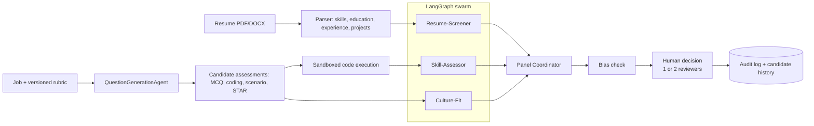

# JASIPA — Job Applicant Screening & Interview Panel Agent

JASIPA takes a candidate from resume screening through skill assessment to an interview-panel recommendation, runs a bias check against every merged decision, and leaves the final decision to a person.

> **Governance rule:** the system never rejects or hires anyone. Agents score evidence and route candidates to a reviewer; every application is closed by an authenticated HR reviewer, with the bias check for that exact panel decision recorded alongside the decision in a tamper-evident audit log.

## Workflow



| Component | Implementation |
| --- | --- |
| Tools | `resume_screen` → `ResumeScreenerAgent`, `skill_assess` → `SkillAssessorAgent` (+ code sandbox), `bias_check` → `BiasCheckerAgent` |
| Skill (rubric) | Versioned, JD-anchored rubric per job (`rubrics` table). Editing creates a new version; past decisions keep theirs. |
| Memory | Candidate stage machine, per-round panel history (`round_number`) fed back into the panel, full audit history. |
| Connector (MCP) | ATS tools over MCP stdio (`python -m app.mcp.stdio_server`) and `/api/mcp`. Recording a human decision is not exposed. |
| Orchestration | LangGraph: dispatch → (screen, skills, culture in parallel) → panel coordinator → bias check. Nodes are pure; persistence happens sequentially in the fan-in. |
| Governance | Panel can only route (`PROCEED_TO_HUMAN_REVIEW`, `HUMAN_REVIEW_REQUIRED`, `ADDITIONAL_INFORMATION_REQUIRED`). Escalated decisions require two different reviewers who agree. |

## Key behaviour

**Question generation.** `QuestionGenerationAgent` builds each job's assessment from its responsibilities, required skills, proficiency level (from minimum experience) and rubric competencies: MCQs, a coding challenge (only when required skills involve programming), scenario questions tied to stated responsibilities, and one STAR question per rubric competency. With an LLM configured, generated items are schema-validated and coding challenges are accepted only if their reference solution passes their own tests in the sandbox; otherwise a deterministic skill-driven generator is used. Sets are cached per job + rubric version, and each applicant is pinned to the set they were shown.

**Code execution.** Candidate code runs in a separate interpreter with a cleared environment, empty working directory, CPU/memory/file-size/process limits, an irremovable audit hook blocking network, subprocess, file-write and filesystem-listing operations, a restricted import list, and per-test plus wall-clock time limits. Expected outputs never enter the sandbox; results are judged in the parent. `SANDBOX_BACKEND=docker` adds a network-less, read-only container. Candidates can run the visible examples (rate limited); hidden tests run on submission.

**Bias checks.** Selection rates by cohort at the AI recommendation and human decision stages with Wilson intervals, four-fifths impact ratios, Fisher's exact tests, minimum group sizes and fragility flags. Results are shown in three states (*Disparity detected*, *No indicator detected*, *Insufficient data*) with significance as a separate qualifier; only the four-fifths screen raises a warning, and insufficient data is never presented as fairness. See [backend/docs/BIAS_AND_OUTCOMES.md](backend/docs/BIAS_AND_OUTCOMES.md).

**Resume upload.** HR (new or existing candidate) and candidates (self-service) can upload PDF or DOCX up to 5 MB. Files are validated by extension and signature, stored under random names, never served statically, and parsed into skills, education, experience (stated or from dated roles) and projects. Active applications are re-screened automatically; resumes are locked once a panel evaluation exists.

## Running locally

Requirements: Python 3.10+ and Node 18+.

```bash
cd backend
python -m venv .venv && .venv/bin/pip install -r requirements.txt
.venv/bin/python scripts/seed_data.py --demo-accounts
LLM_PROVIDER=mock .venv/bin/uvicorn app.main:app --reload --port 8000
```

```bash
cd frontend
npm install
npm run dev
```

Open http://localhost:5173. The seed script resets the database and imports 8 resumes per category from six categories of the Kaggle Resume Dataset (`Resume.csv` in the repository root), each with an authored job description, and screens them. Dataset records are marked `source=dataset_import`, have no cohort label and no assessments, and are kept apart from real applicants; no synthetic candidates, answers or decisions are created. Accounts (also shown on the sign-in page in development builds):

| Account | Password | Use |
| --- | --- | --- |
| hr@jasipa.ai | admin123 | HR reviewer |
| reviewer@jasipa.ai | reviewer123 | Second reviewer for two-reviewer decisions |
| student@jasipa.ai | student123 | Empty candidate portal account (with `--demo-accounts`) |
| candidate@jasipa.ai | candidate123 | Second empty candidate account (with `--demo-accounts`) |

Set `GEMINI_API_KEY` and `LLM_PROVIDER=gemini` to enable LLM scoring, question generation and summaries; everything works without them. Set `SECRET_KEY` outside local development (a random per-process key is used otherwise, so sessions reset on restart). See `.env.example` for all settings.

Import more Kaggle resumes without resetting: `.venv/bin/python scripts/import_dataset.py ../Resume.csv`. A demo walkthrough and known constraints are in [docs/ENGINEERING_NOTES.md](docs/ENGINEERING_NOTES.md).

### Docker

```bash
SECRET_KEY=$(python -c "import secrets; print(secrets.token_urlsafe(48))") docker compose up --build
```

`SEED_DEMO_DATA=true` (default) resets and seeds the database on every backend start; set it to `false` to keep data.

## Tests

```bash
python scripts/run_all_tests.py        # pytest + Vitest + Playwright; writes docs/test-results/
cd backend && .venv/bin/python -m pytest
cd frontend && npm test                # component tests
cd frontend && npm run test:e2e        # needs: npx playwright install chromium
```

`run_all_tests.py` writes the executed test-case table (`TEST_CASES.md`, `test_cases.csv`, `summary.json`) from the runners' result files. The backend suite runs against an isolated, freshly seeded SQLite database and covers authentication and data isolation, sandbox correctness and escape attempts, question generation and validation, resume parsing and upload errors, small-cohort statistics, the end-to-end pipeline, two-reviewer decisions, MCP, and audit-chain tamper detection.

## Known limitations

* The subprocess sandbox is defense in depth, not a hardened security boundary; use `SANDBOX_BACKEND=docker` in production. Coding challenges are Python only.
* HR accounts are a fixed demo list in code; there is no user management, password reset, SSO or login rate limiting.
* Without an LLM, open-ended answers are scored with a keyword rubric and STAR-structure detection, which are coarse proxies for answer quality.
* Agents do not learn from decisions or outcomes (see docs/ENGINEERING_NOTES.md §2).
* Cohort tags are supplied by HR; the Kaggle dataset has none; there is no voluntary self-identification flow. Bias statistics are only as good as that data.
* Scanned (image-only) resumes are rejected rather than OCR'd.
* Schema changes are applied by an additive migration (new nullable columns); there is no Alembic history.

## Project deliverables

* Report: [docs/report/main.pdf](docs/report/main.pdf) (LaTeX sources in `docs/report`, built with `tectonic -X compile main.tex`)
* Presentation: [docs/presentation/JASIPA_presentation.pptx](docs/presentation/JASIPA_presentation.pptx) (+ PDF; `build_deck.py`)
* Poster (A1): [docs/poster/JASIPA_poster.pdf](docs/poster/JASIPA_poster.pdf) (`build_poster.py`)
* Test results: [docs/test-results/TEST_CASES.md](docs/test-results/TEST_CASES.md)
* Engineering notes (bias status, learning, regeneration fix, demo): [docs/ENGINEERING_NOTES.md](docs/ENGINEERING_NOTES.md)
